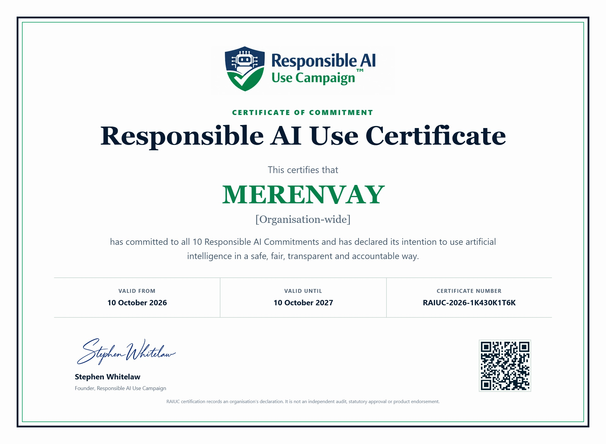

# MERENVAY Responsible AI Use Certificate of Commitment

This record accompanies the original, unmodified certificate image supplied by MERENVAY. The certificate records MERENVAY's organisation-wide declaration to all 10 Responsible AI Commitments and its stated intention to use artificial intelligence in a safe, fair, transparent and accountable way.

## Certificate details

- Programme: **Responsible AI Use Campaign**
- Certificate type: **Certificate of Commitment**
- Holder: **MERENVAY**
- Scope printed on the certificate: **Organisation-wide**
- Certificate number: **RAIUC-2026-1K430K1T6K**
- Valid from: **10 October 2026**
- Valid until: **10 October 2027**
- Signatory: **Stephen Whitelaw**, Founder, Responsible AI Use Campaign

## Meaning and limits

The certificate records an organisation's declaration. It is not an independent audit, statutory approval or product endorsement. No technical-performance score, legal immunity or independent validation of the ARC-AGI evaluation results is claimed on the basis of this certificate.

The dates above are reproduced from the certificate. This repository preserves a copy and does not provide live confirmation of the issuer's current certificate status. To check current status, use the [issuer's certificate search](https://www.raiuc.org/certificate-search) with certificate number **RAIUC-2026-1K430K1T6K**. See the [issuer's governance and certification rules](https://www.raiuc.org/governance-certification) for display and use requirements.

## Original certificate image

[Open the original JPEG](RAIUC-certificate-RAIUC-2026-1K430K1T6K.jpg)

- File: `RAIUC-certificate-RAIUC-2026-1K430K1T6K.jpg`
- Format and dimensions: JPEG, 2040 × 1498 pixels
- File size: 294,192 bytes
- SHA-256: `88672f92156229015599e9d050a169410745378895ac83026417d2db2ac4e4e5`

The checksum identifies the exact image stored here; it is not issuer authentication or an independent audit.
